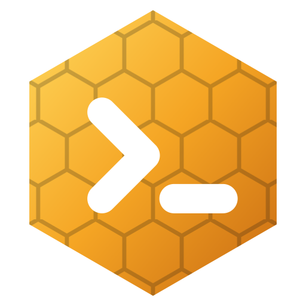

<div align="center">



# ByteHive

**Spawn & orchestrate fleets of AI agent CLIs, real terminals, real tree-kill.**

[](https://github.com/tdat-dev/maestro-releases/releases/latest)
[](LICENSE)
[](https://github.com/tdat-dev/maestro-releases/releases/latest)
[](https://github.com/emilk/egui)

A native Windows desktop app for running many AI coding agents side by side , 
Claude Code, Codex, Gemini, Aider, Cursor Agent, Copilot, and more, each in a
real ConPTY terminal, with a queue of who needs you, review of what each one
changed, and a board the agents plan on.

[Download the latest installer »](https://github.com/tdat-dev/maestro-releases/releases/latest)

</div>

---

## Why

Running one AI CLI is easy. Running **eight of them across three repos** , 
spawning, watching, killing, reviewing what each one changed, is a tab-juggling
nightmare. ByteHive turns that into a single orchestrated surface: one window,
tiled live terminals, one broadcast bar, one diff review.

## Features

- **Workspace wizard**, pick a folder, tap a tile for how many terminals
  (1–12, with live grid preview), multi-select which models fill them, hit
  spawn. Recent folders and one-click **presets** (folder + models + count
  baked in) make respawning a whole crew a single tap.
- **Real terminals**, every agent runs in a genuine Windows ConPTY via a Rust
  backend (xterm.js front), with tree-kill on close so no orphaned `node.exe`
  swarms survive.
- **11 CLIs built in, plus custom**, Claude Code, Codex, Gemini, Aider,
  Cursor Agent, opencode, Qwen Code, GitHub Copilot, Goose, PowerShell, CMD,
  or any command you type. Optional skip-permissions flag per spawn.
- **Frameless tiling**, terminals run edge-to-edge with a floating control
  pill per pane (search, maximize, restart, kill). Drag pills to reorder
  panes; drag tabs to reorder workspaces.
- **Detach & merge windows**, drag a workspace tab out to give it its own
  window; drag it back (or hit *Merge*) to fold it into the main window.
  Agents keep running through both moves.
- **Broadcast**, type once, send to every running agent (or a selected
  subset).
- **Git worktree isolation**, optionally give each agent its own worktree +
  branch off HEAD, so parallel agents never trample each other and every
  agent's changes are reviewable in isolation.
- **AI Code review**, built-in diff viewer to walk through what each agent
  changed.
- **Quality of life**, Ctrl+Click links in terminal output, find-in-output,
  copy-on-select, drag-and-drop a file onto a pane to paste its path, session
  restore, system tray, signed auto-updates… and a mascot who lives on the
  home screen.

## MCP server (agent ⇄ board)

ByteHive ships a kanban board per workspace (`.bytehive/board.json`). The
[`bytehive-mcp`](mcp/README.md) package exposes that board to any MCP-capable
agent (Claude Code, etc.) as tools, read the board, add/move/update/delete
cards, so an agent can manage its own task list from inside the terminal
you spawned it in. Dispatch works the other way too: send a card to a
specific agent from the board (it records the assignee and reports back when
the agent marks it done).

```
claude mcp add --scope user bytehive -- npx -y bytehive-mcp
```

On native Windows, wrap with `cmd /c` (see [mcp/README.md](mcp/README.md) for
why). See that README for the full tool reference, the local-checkout install
command, and a worktree-isolation caveat.

## Install

Grab `ByteHive_<version>_x64-setup.exe` from the
[latest release](https://github.com/tdat-dev/maestro-releases/releases/latest) and run
it. ByteHive updates itself from then on (signed releases; Settings > System).
An older Tauri-based ByteHive moves onto this one through its own updater.

> **Requirements:** Windows 10/11 x64. The AI CLIs themselves (`claude`,
> `codex`, `opencode`, ...) must be on your `PATH`: ByteHive launches them, it
> doesn't install them.

## Development

ByteHive is a native Rust app (egui). Each crate is its own Cargo workspace.

```powershell
git clone https://github.com/tdat-dev/maestro.git
cd bytehive\crates\native-shell
cargo run             # the app
cargo test            # its tests (also run in crates/agent-core, supervise, dashboard, browser-hub)
cd ..\..
npm run check:length  # no source file over 500 lines
npm run installer     # release build + NSIS installer (needs NSIS 3)
```

Prerequisites: Rust (stable, MSVC toolchain), Node 22 (for the MCP server and
the tools), NSIS 3 for the installer.

### Project layout

```
crates/native-shell/   the app: egui UI, terminals, review, board, settings, tray, updater
crates/agent-core/     headless core: PTY agents, registry, CLI transcripts, git, land, plan usage
crates/supervise/      supervisor logic: task state, asks, stuck/clash, digests, limits, finishes
crates/dashboard/      the phone dashboard server (password gate, web terminal)
crates/browser-hub/    ByteHive for Chrome: hub, native messaging host, profiles
mcp/                   bytehive-mcp: board, memory, fleet and browser tools for the agents
browser-extension/     the Chrome extension
docs/                  releasing guide and design notes
```

### Releasing

Bump `version` in `crates/native-shell/Cargo.toml` (and `package.json`), add a
`## [x.y.z]` section to CHANGELOG.md, then push a `vx.y.z` tag: the Release
workflow builds the installer, signs it with the updater key, and publishes it
with `latest.json` to tdat-dev/maestro-releases.

## License

[MIT](LICENSE) © 2026 [tdat-dev](https://github.com/tdat-dev)

Built with [egui](https://github.com/emilk/egui), [alacritty_terminal](https://crates.io/crates/alacritty_terminal) and
[portable-pty](https://crates.io/crates/portable-pty).
